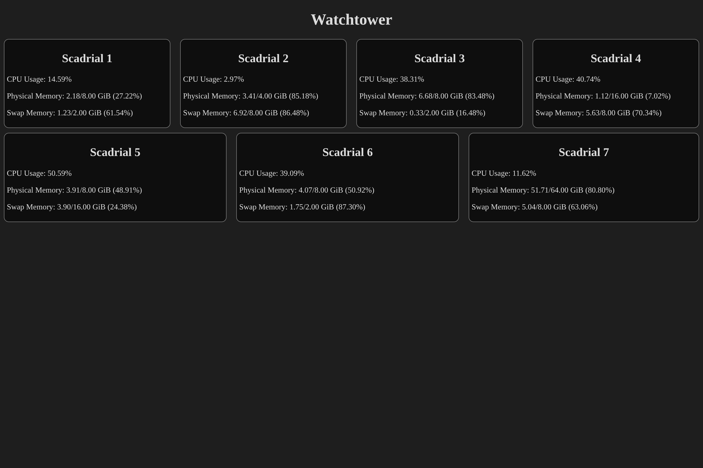

Software to monitor multiple Linux machines. Consists of an agent that runs on each machine that communicates with a central server, which can then be queried and interfaced through a webpage.

Go check out an example deployment [here](http://watchtower.draedon.xyz)!

# Usage

## Required Software

- [Node.js](https://nodejs.org/en)
- [pnpm](https://pnpm.io)
- [Rust](https://rust-lang.org)
- [Linux](https://www.linux.org) (for the agents)

## Building from Source

### Server

1. `cd` into `apps/server`
2. Run `cargo build -r`
3. Locate your built executable at `target/release/watchtower-server`

### Agent

Note: the agent only runs on Linux devices

1. `cd` into `apps/agent`
2. Run `cargo build -r`
3. Locate your built executable at `target/release/watchtower-agent`

### Web Interface

1. `cd` into `apps/web`
2. Change the server address in `apps/web/src/lib/request.svelte.ts` to match the address and port of the server. This defaults to `http://127.0.0.1:9824` if in a dev environment (e.g., if the webpage is hosted with `pnpm dev`) and defaults to `http://watchtowerapi.draedon.xyz` if in production
3. Run `pnpm i && pnpm build`
4. Locate your built webpage at `apps/web/build`

## Running

1. Download the precompiled executables and webpage from the latest release, or build it from source, as instructed above. Unzip the webpage if downloaded from the release
2. `cd` into the location of the `watchtower-server` executable
3. Run `./watchtower-server --password "YOUR_PASSWORD"`. For more help, run `./watchtower-server -h`
4. `cd` into the location of the `watchtower-agent` executable
5. Run `./watchtower-agent --password "YOUR_PASSWORD" --watchtower-address "ADDRESS:PORT"` where `ADDRESS:PORT` is the address and port of the server. Defaults to `127.0.0.1:9824`. For more help, run `./watchtower-agent -h`
6. `cd` into the location of the webpage
7. Host the webpage located with any method. Possible methods include (but are not limited to) running `pnpm preview` or hosting it on Vercel/other static site hosters

# Licence

This project is licensed under the [MIT License](https://mit-license.org).

The JetBrains Mono font files (both the [regular](apps/web/static/fonts/JetBrainsMono[wght].ttf) and [italic](apps/web/static/fonts/JetBrainsMono-Italic[wght].ttf) variant) are licensed under the [SIL Open Font License 1.1](https://github.com/JetBrains/JetBrainsMono/blob/master/OFL.txt).
